Brazilian developer with professional experience building solutions for ERP systems. Currently pursuing a degree in Systems Analysis and Development and strengthening my backend development skills with Java and Spring Boot.

<picture>
  <source media="(prefers-color-scheme: light)" srcset="assets/title-experience-light.svg">
  
</picture>

**Internship** · Prominas Brasil Equipamentos LTDA  
`2025 – Present`
- Developing custom dashboards and reporting screens to track key business metrics (sales, purchasing, production, and quality).
- Working with the Sankhya ERP platform, developing custom solutions using Java/JSP, SQL, JavaScript, HTML, and CSS.
- Working directly with relational databases, writing complex SQL queries for data extraction and analysis, and implementing backend logic in Java/JSP for data persistence and CRUD operations within the ERP ecosystem.
- Providing technical support to users and assisting with ERP operations and system-related troubleshooting.

**Software Development Project** · Faculdade de Tecnologia e Escola SENAI Antonio Adolpho Lobbe  
`2026 – Present`
- Leading the end-to-end development of a student service platform for the university's student support department.
- Working under professor mentorship, currently responsible for requirements gathering and system architecture.
- Responsible for the upcoming implementation, testing, and deployment phases.

<picture>
  <source media="(prefers-color-scheme: light)" srcset="assets/title-skills-light.svg">
  
</picture>

**Backend & Database**  

**Frontend**  

**Development Tools & AI**  

<picture>
  <source media="(prefers-color-scheme: light)" srcset="assets/title-contact-light.svg">
  
</picture>

